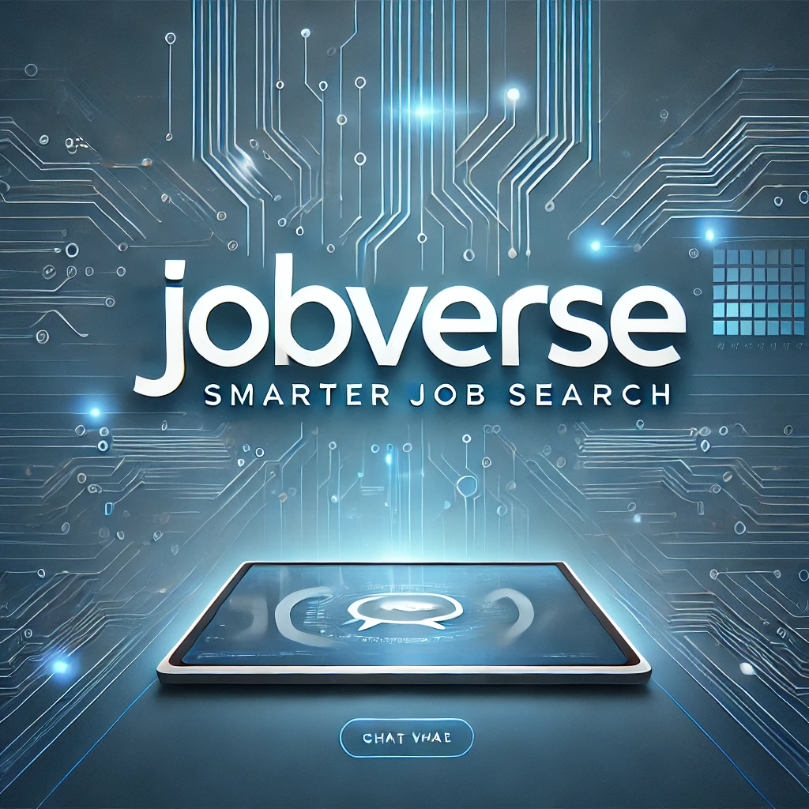
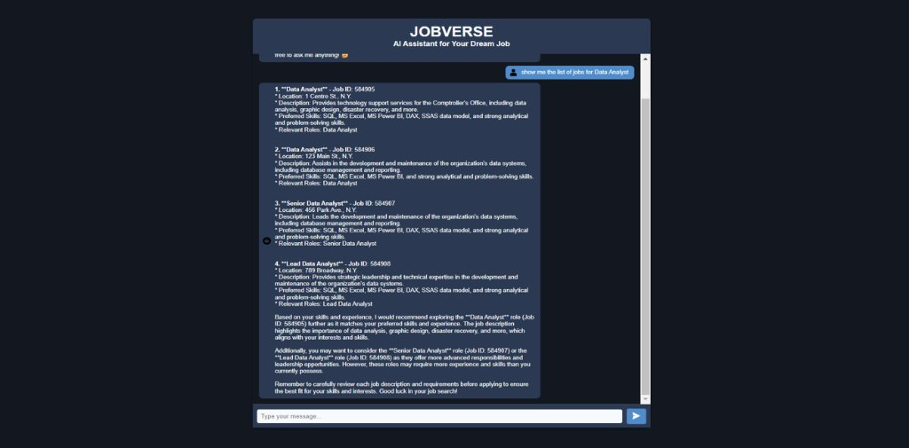
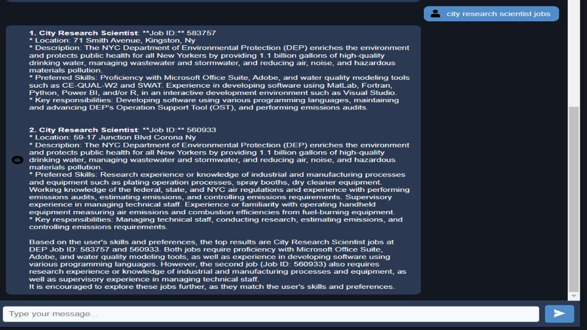
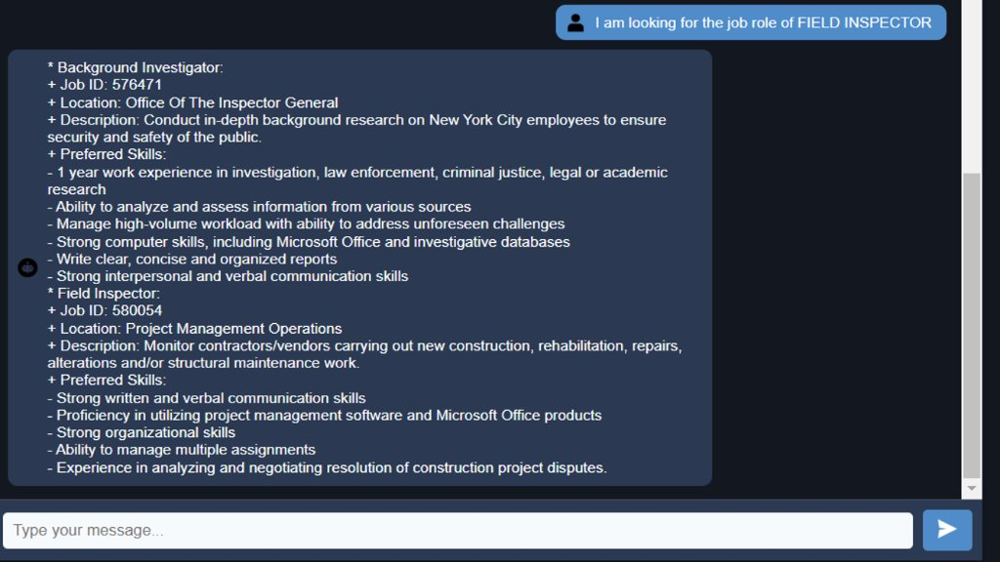
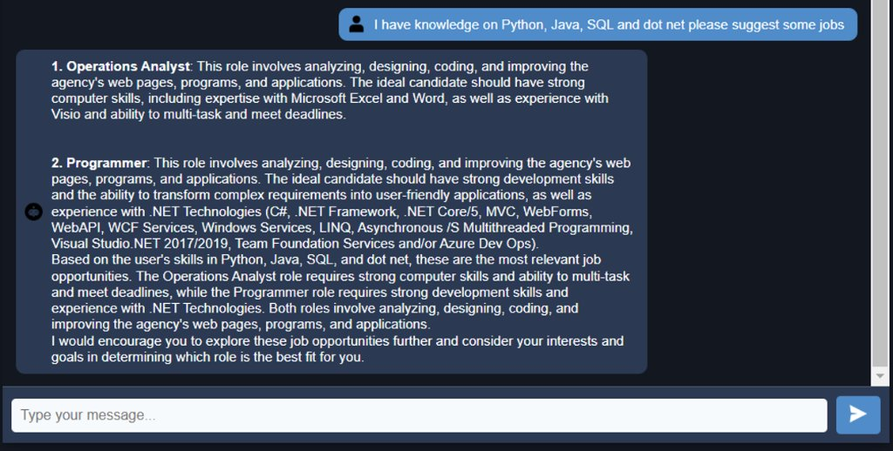
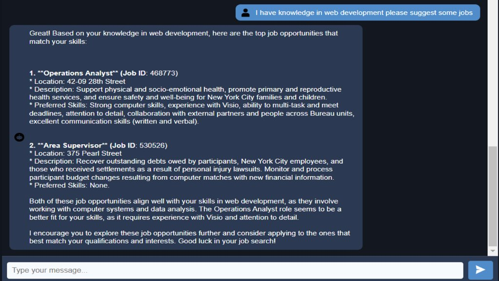

# 🌐 Job_AI_Chatbot — AI-Powered Job Search Chatbot

<p align="center">
  
</p>

<p align="center">
  <strong>An intelligent Retrieval-Augmented Generation (RAG) chatbot that helps job seekers find and explore tailored NYC municipal employment opportunities using semantic vector search and local AI.</strong>
</p>

<p align="center">
  
  
  
  
  
</p>

<p align="center">
  <a href="#-about">About</a> •
  <a href="#-demo-screenshots">Screenshots</a> •
  <a href="#-features">Features</a> •
  <a href="#-architecture--how-it-works">Architecture</a> •
  <a href="#%EF%B8%8F-tech-stack">Tech Stack</a> •
  <a href="#-setup--installation-guide">Setup Guide</a> •
  <a href="#-usage">Usage</a>
</p>

---

## 📖 About

Traditional public-sector job boards rely on rigid keyword filters and civil service jargon. Searching for *"software engineer"* or *"web developer"* frequently misses roles titled *"Applications Software Specialist"* or *"Operations Analyst"*, even when candidate skills match perfectly.

**Job_AI_Chatbot** solves this using an end-to-end **Retrieval-Augmented Generation (RAG)** pipeline:
- **Semantic Understanding**: Converts natural language queries into 384-dimensional dense vectors using `sentence-transformers/all-MiniLM-L6-v2`, matching candidate intent and skills rather than literal keywords.
- **Fast Similarity Search**: Uses **FAISS** index to retrieve top matching jobs from the NYC Jobs dataset in milliseconds.
- **Local AI Synthesis**: Passes matched jobs to **LLaMA 2** (served locally via **Ollama**) to generate structured, human-readable recommendations with Job IDs, requirements, and insights.
- **100% Private & Self-Hosted**: Runs entirely offline on local hardware with zero external API fees or data leakage.

---

## 📸 Demo Screenshots

<details>
<summary>🔍 <b>Click to Show More: View Conversation Demos (5 Screenshots)</b></summary>
<br>

<p align="center">
  
  <br>
  <em>Figure 1: Query for Data Analyst positions displaying role summaries, locations, and recommendations.</em>
</p>

<br>

<p align="center">
  
  <br>
  <em>Figure 2: Inquiring about specialized City Research Scientist roles across municipal departments.</em>
</p>

<br>

<p align="center">
  
  <br>
  <em>Figure 3: Targeted search for Field Inspector and Background Investigator roles.</em>
</p>

<br>

<p align="center">
  
  <br>
  <em>Figure 4: Multi-skill query ("Python, Java, SQL, and .NET") matched to Programmer and Operations Analyst roles.</em>
</p>

<br>

<p align="center">
  
  <br>
  <em>Figure 5: Candidate asking for web development opportunities receiving tailored job options.</em>
</p>

</details>

---

## ✨ Features

- 🔍 **Semantic Search** — Understands meaning, synonyms, and context beyond simple keyword matching.
- 🎯 **Skill-Based Matching** — Enter languages, tools, or frameworks (e.g. Python, SQL, web dev) to find relevant roles.
- 🤖 **Local LLM Summaries** — Clear, actionable summaries powered by LLaMA 2 via Ollama.
- 💬 **Clean Dark Chat UI** — Responsive chat interface with user and assistant message styling.
- 🛡️ **Intent Detection** — Handles casual greetings and clarifies out-of-scope questions.
- 🧹 **Deduplicated Results** — Cleans and deduplicates postings automatically.
- ⚡ **Offline & Private** — Runs without cloud APIs or token costs.

---

## 🧠 Architecture & How It Works

Job_AI_Chatbot utilizes a three-stage RAG workflow: **Embed Query → Vector Search (FAISS) → LLM Synthesis (LLaMA 2 via Ollama)**.

<details>
<summary>📊 <b>Click to Show More: View Architecture Flowchart & Technical Breakdown</b></summary>
<br>

```
┌────────────────────────────────────────────────────────┐
│                   User Query                           │
│         e.g., "I know Python and SQL, suggest jobs"    │
└───────────────────────────┬────────────────────────────┘
                            │
                            ▼
┌────────────────────────────────────────────────────────┐
│ 1. Vector Embedding (SentenceTransformers)             │
│    Model: sentence-transformers/all-MiniLM-L6-v2       │
│    Transforms query into a dense 384-d vector          │
└───────────────────────────┬────────────────────────────┘
                            │
                            ▼
┌────────────────────────────────────────────────────────┐
│ 2. Similarity Search (FAISS Vector Index)              │
│    Calculates cosine / L2 distance across embeddings   │
│    Retrieves top-k closest matching NYC job records   │
└───────────────────────────┬────────────────────────────┘
                            │
                            ▼
┌────────────────────────────────────────────────────────┐
│ 3. Response Generation (LLaMA 2 via Ollama)           │
│    Combines retrieved jobs + query into LLM context    │
│    Produces structured recommendations & takeaways     │
└───────────────────────────┬────────────────────────────┘
                            │
                            ▼
┌────────────────────────────────────────────────────────┐
│                   Final Chat UI Response               │
│           Job Titles • IDs • Locations • Advice        │
└────────────────────────────────────────────────────────┘
```

### Pipeline Components:
1. **Preprocessing (`data_preprocessing.py`)**: Cleans raw NYC Jobs data, eliminates redundant civil service codes, removes duplicate postings, and prepares unified text chunks.
2. **Embeddings (`generate_embeddings.py`)**: Computes dense numerical representations for all postings using SentenceTransformers.
3. **Indexing (`save_embeddings.py`)**: Serializes embeddings into a FAISS index (`.idx`) for sub-second nearest neighbor lookup.
4. **Search & Inference (`query_search.py` & `response_generator.py`)**: Converts incoming user queries to vectors, queries FAISS, and streams retrieved records to LLaMA 2 for the final response.

</details>

---

## 🛠️ Tech Stack

| Area | Technologies |
|---|---|
| **Backend & API** | Python 3.8+, Flask, Requests |
| **Frontend** | HTML5, CSS3, Modern Vanilla JavaScript |
| **Embeddings & Search** | `sentence-transformers/all-MiniLM-L6-v2`, FAISS (CPU/GPU) |
| **LLM Inference** | LLaMA 2 running locally on Ollama |
| **Data Processing** | Pandas, NumPy, Pickle |

<details>
<summary>🗂️ <b>Click to Show More: Project Directory Tree</b></summary>
<br>

```
Job_AI_Chatbot/
├── app.py                     # Flask server and API endpoints
├── data_preprocessing.py      # Cleans raw NYC job listings
├── generate_embeddings.py     # Generates sentence embeddings
├── save_embeddings.py         # Builds FAISS vector index
├── query_search.py            # Vector search logic
├── response_generator.py      # Ollama/LLaMA 2 response generation logic
├── logger_config.py           # Logging setup
├── .env                       # Environment configuration
├── screenshots/               # Conversation demo screenshots
├── raw_data/                  # Original NYC Jobs dataset
├── cleaned_data/              # Preprocessed data
├── embedding_data/            # Vector embeddings (CSV)
├── idxfile/                   # FAISS index file (.idx)
├── picklefile/                # Metadata & serialized embeddings
├── templates/index.html       # Web chat interface
└── static/                    # CSS, JavaScript, and icons
```

</details>

---

## 🚀 Setup & Installation Guide

Follow these steps to set up and run the project locally on your machine.

### 1. Prerequisites
Ensure you have the following installed:
* **Python 3.8 or higher**: [python.org/downloads](https://www.python.org/downloads/)
* **Git**: [git-scm.com](https://git-scm.com/)
* **Ollama**: [ollama.ai/download](https://ollama.ai/download) (used to run the LLaMA 2 model locally)

---

### 2. Clone the Repository
Clone the repository and enter the project directory:

```bash
git clone https://github.com/Swarnim0611/Job_AI_Chatbot.git
cd Job_AI_Chatbot
```

---

### 3. Create & Activate Virtual Environment
Isolate dependencies using a Python virtual environment:

```bash
# Create virtual environment
python -m venv venv

# Activate on Windows:
venv\Scripts\activate

# Activate on macOS / Linux:
source venv/bin/activate
```

---

### 4. Install Dependencies
Install all required libraries via pip:

```bash
pip install flask pandas numpy sentence-transformers faiss-cpu python-dotenv requests pickle5
```

> **Tip:** If you have an NVIDIA GPU with CUDA installed, replace `faiss-cpu` with `faiss-gpu` for accelerated vector search.

---

### 5. Set Up & Start Ollama (LLaMA 2)
Ollama runs the large language model locally on your system:

1. **Pull the LLaMA 2 model** (run once):
   ```bash
   ollama pull llama2
   ```

2. **Start the Ollama server**:
   ```bash
   ollama serve
   ```
   *Keep this terminal window open. Ollama listens on `http://localhost:11434` by default.*

---

### 6. Configure Environment Variables (`.env`)
Create a `.env` file in the project root to define data paths and model name:

```env
# File Paths (relative to project root)
RAW_DATA_PATH=./raw_data/NYC_Jobs.csv
CLEANED_DATA_PATH=./cleaned_data/cleaned.csv
EMBEDDINGS_OUTPUT_PATH=./embedding_data/embedded_output.csv
CSV_EMBEDDINGS=./embedding_data/embedded_output.csv
IDX_FILE_PATH=./idxfile/faiss_index.idx
METADATA_OUTPUT_PATH=./picklefile/meta_data.pkl

# Sentence Transformer Model
MODEL_NAME=sentence-transformers/all-MiniLM-L6-v2
```

---

### 7. Data Pipeline (Optional for Pre-existing Data)
The repository comes with pre-computed index and metadata files in `idxfile/` and `picklefile/`. 

If you want to re-process data or use a new dataset from scratch:
```bash
# Step 1: Clean raw CSV
python data_preprocessing.py

# Step 2: Generate embedding vectors
python generate_embeddings.py

# Step 3: Build the FAISS similarity index
python save_embeddings.py
```

---

### 8. Run the Application
In a new terminal (with your virtual environment activated):

```bash
python app.py
```

The Flask server will start on:
```
http://localhost:8000
```

Open your browser, navigate to `http://localhost:8000`, and start chatting!

---

## 💬 Usage

### Example Queries
- `"Show me data analyst jobs in Manhattan"`
- `"I know Python, Java, and SQL. What roles match my skills?"`
- `"What positions are available in web development?"`
- `"Search for field inspector or safety investigator roles"`
- `"Hello! How can you help me find a job?"`

### REST API Endpoint
You can also send queries directly via HTTP POST:

```bash
curl -X POST http://localhost:8000/search \
  -H "Content-Type: application/json" \
  -d '{"query": "data analyst jobs in Manhattan", "top_n": 3}'
```

---

## ⚠️ Troubleshooting

| Problem | Cause | Solution |
|---|---|---|
| `Connection refused` on query | Ollama is not running | Run `ollama serve` in a separate terminal |
| `Model not found` | LLaMA 2 model is not pulled | Run `ollama pull llama2` |
| `FileNotFoundError` for `.idx` or `.pkl` | Index files missing or paths wrong in `.env` | Run Step 7 data pipeline or check `.env` paths |
| `ModuleNotFoundError` | Missing package | Ensure virtual environment is activated and run `pip install <package>` |
| First query takes longer | Model loading into memory | Normal behavior; subsequent queries run much faster |

